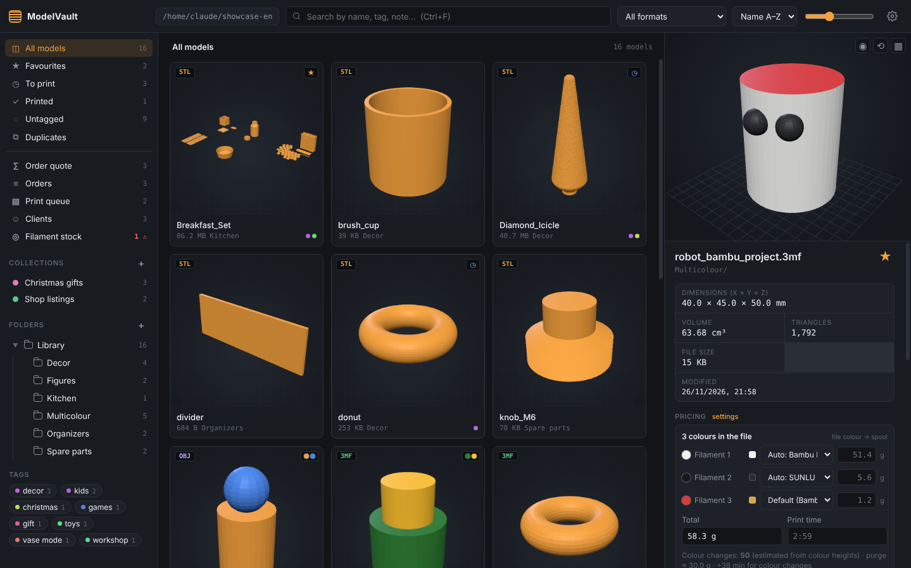
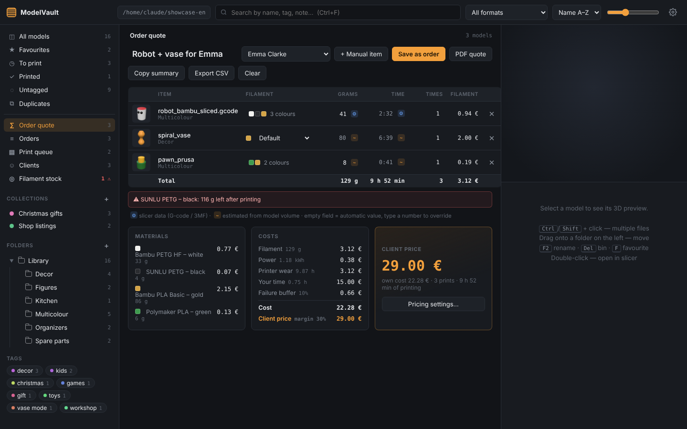
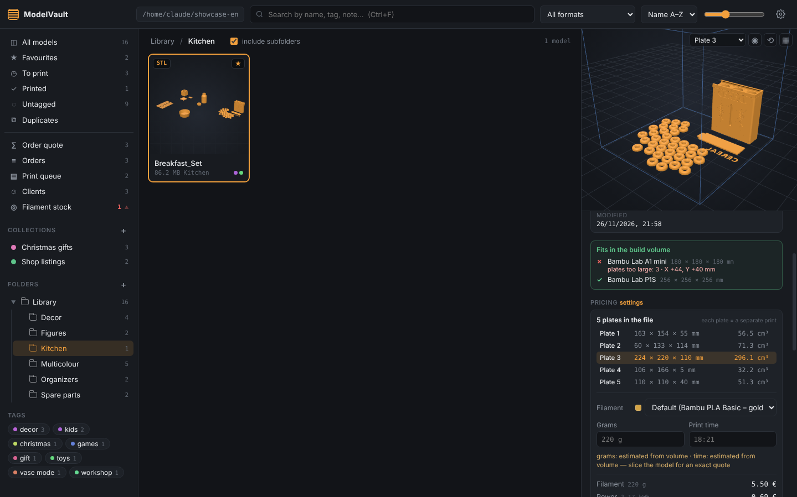
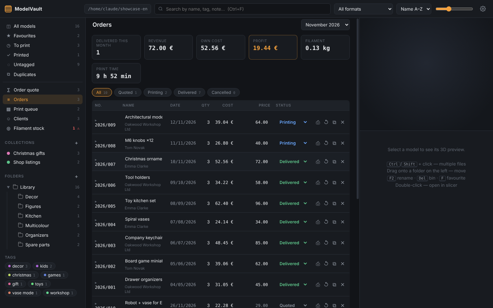
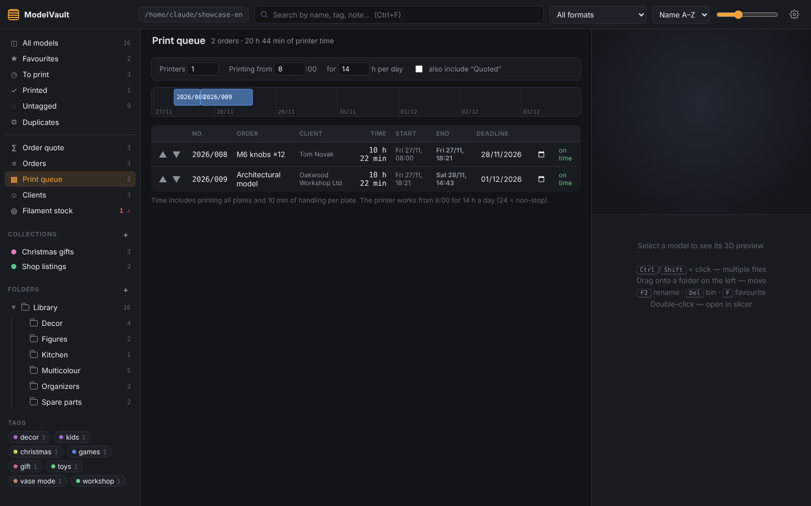
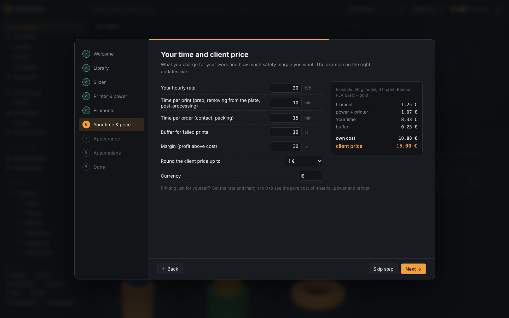
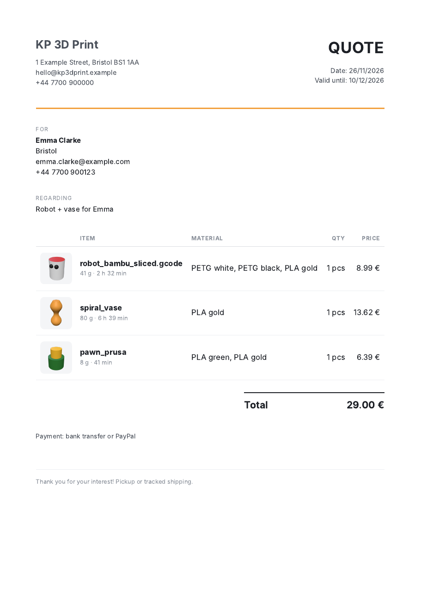

<div align="center">


# ModelVault

**A desktop library manager for 3D printing models, with 3D preview, print pricing, orders and filament stock.**

[](https://github.com/K-Ptak/ModelVault/actions/workflows/ci.yml)


[](LICENSE)




</div>

---

ModelVault turns an ordinary folder of STL, 3MF and G-code files into an organised library.
You get a 3D preview, categories and tags, and a price for every print that covers filament,
electricity, printer wear and your own time. **Your files stay where they are.** Folders are categories,
so everything keeps working in File Explorer, and the app picks up changes as they happen.

> **Status:** version 1.0 is in active development and has not been released yet.

## Contents
- [Features](#features)
- [Screenshots](#screenshots)
- [Supported formats](#supported-formats)
- [How pricing works](#how-pricing-works)
- [Installation](#installation)
- [How it works](#how-it-works)
- [Development](#development)
- [License](#license)

## Features

### 📁 Library
- **A folder is your library.** Subfolders are categories, and drag-and-drop moves the real files.
- **Tags, favourites and statuses** ("to print", "printed"), plus notes and a source link (Printables, MakerWorld, Thingiverse).
- **Collections:** virtual groups such as "Christmas gifts" that don't move any files.
- **Search** by name, path, tags and notes, with a format filter and sorting.
- **Duplicate detection:** finds files with identical content, even when their names differ.
- **"To sort" inbox:** new models from your Downloads folder land in the library, and ZIP archives are extracted automatically.

### 🧊 3D preview
- **Live preview** with orbit controls, a print bed grid, wireframe mode and G-code toolpaths.
- **Thumbnails:** embedded by the slicer, taken from an image next to the model, or rendered. You can set the camera angle or use a photo of the finished print.
- **Multicolour models:** reads filament assignments and painting from 3MF files (Bambu Studio, OrcaSlicer, PrusaSlicer) and T0…Tn tools from G-code. Each colour is shown separately.
- **Multiple plates in one file:** detects plates in Bambu Studio / MakerWorld exports, previews a single plate and shows each plate's dimensions.
- **Build volume check:** pick your printers from a built-in library of 34 models (Bambu Lab, Prusa, Creality, Elegoo, Anycubic, Qidi, Voron…) or enter the bed size yourself. Models that don't fit any of your printers get a ⤢ badge, plates are checked one by one, a 90° rotation on the bed is taken into account, and the 3D preview draws the build volume outline.
- **Damaged files are handled gracefully:** empty, truncated or corrupted STL / 3MF / OBJ / PLY / G-code files get a ! badge and a clear explanation (e.g. "contains 58 of 5,184 triangles — interrupted download?") instead of breaking the app.

### 💰 Pricing
- **The full cost of a print:** filament, electricity (including warm-up energy), printer depreciation and servicing, your time, a buffer for failed prints, margin and price rounding.
- **Slicer data:** grams and time from G-code (PrusaSlicer, OrcaSlicer, Bambu Studio, Cura) and from sliced 3MF files, per filament and including purge. Without slicer data, an estimate is made from the model's volume.
- **Several spools per model:** one spool per colour, matched automatically to the colours in the file. Colour changes, purge and change time are estimated.
- **Order quotes** combining many models and manual items, with CSV export and a copyable summary.

### 📦 Orders, clients and stock
- **Order history:** numbering, statuses (quoted → printing → delivered), the price agreed with the client, and notes.
- **Client list** with order count, revenue and profit for each client.
- **PDF quote:** a document with thumbnails, materials and item prices, ready to send to a client.
- **Print queue:** a schedule of orders with estimated finish times based on your number of printers and working hours, plus a Gantt chart and deadline tracking.
- **Statistics:** revenue, cost and profit over 12 months, profit by category, and filament usage.
- **Filament stock:** spool levels, the value of filament in stock, low-spool warnings, and automatic deduction of usage that you can undo.

### ⚙️ Convenience
- **First-run wizard:** set up your folder, slicer, printer, prices and margin, with an example quote that updates live.
- **Slicer integration:** detects installed slicers and opens a model in your chosen one with a single click. Only slicers you actually have are shown.
- **Backups:** an automatic daily backup, plus export and import of settings, orders, clients and library metadata.
  If the settings or library metadata file gets corrupted, ModelVault restores it from the latest backup and keeps the damaged copy instead of overwriting it.
- **Languages:** English, Polish and German. The language is picked from your system and can be changed in the wizard or in Settings → Appearance.

## Screenshots

<table>
  <tr>
    <td width="50%"><p align="center"><sub><b>Order quote</b>: many models, many spools, stock warnings</sub></p></td>
    <td width="50%"><p align="center"><sub><b>Multiple plates and build volume</b>: each plate is priced and checked against your printers</sub></p></td>
  </tr>
  <tr>
    <td><p align="center"><sub><b>Orders and statistics</b>: revenue, cost, profit</sub></p></td>
    <td><p align="center"><sub><b>Filament stock</b>: spool levels and usage history</sub></p></td>
  </tr>
  <tr>
    <td><p align="center"><sub><b>Print queue</b>: schedule and deadlines</sub></p></td>
    <td><p align="center"><sub><b>Setup wizard</b>: the example quote updates live</sub></p></td>
  </tr>
</table>

<details>
<summary><b>Sample PDF quote</b></summary>
<br>

</details>

## Supported formats

| Format | 3D preview | Colours | Plates | Pricing data |
|---|:---:|:---:|:---:|---|
| **3MF** (Bambu Studio, OrcaSlicer) | ✅ | ✅ parts, painting | ✅ from the file | grams per filament and time (sliced project) |
| **3MF** (PrusaSlicer) | ✅ | ✅ parts, MMU painting | | estimate |
| **3MF** (core, e.g. Fusion 360) | ✅ | ✅ materials | ✅ detected | estimate |
| **G-code** | ✅ toolpaths | ✅ tools T0…Tn | | grams per filament, time, colour changes |
| **STL** | ✅ | | ✅ detected | estimate from volume |
| **OBJ** | ✅ | ✅ materials (`usemtl`) | ✅ detected | estimate from volume |
| **PLY** | ✅ | ✅ vertex colours | | estimate from volume |
| STEP, SCAD, F3D, BLEND, AMF, GLB… | — | | | listed, with tags and notes |

## How pricing works

| Component | Formula |
|---|---|
| Filament | grams ÷ 1000 × price per kg (separately for each spool) |
| Electricity | (print time × printer power + number of prints × warm-up energy) × price per kWh |
| Printer | print time × (printer price ÷ lifetime + servicing per hour) |
| Your time | (number of prints × time per print + time per order) × hourly rate |
| Buffer | (filament + electricity + printer) × failed-print percentage |
| **Cost** | sum of the above |
| **Client price** | cost × (1 + margin), optionally rounded up |

Each plate in a multi-plate file counts as a separate print. Every parameter can be changed in Settings, and the currency is up to you.

## Installation

> The first release is being prepared. Once it is published, the installer and the portable version will appear
> under [Releases](https://github.com/K-Ptak/ModelVault/releases).

Planned release files:
- **`ModelVault-Setup-x.y.z.exe`**: an installer with a Start menu shortcut and automatic updates.
- **`ModelVault-x.y.z-win-x64.zip`**: a portable version that needs no installation.

Until then you can run the app from source (see [Development](#development)).

## How it works

- **Your files are never converted.** The library is a folder on disk, and actions such as moving,
  renaming or deleting (to the Recycle Bin) work on the real files.
- **Library metadata** (tags, notes, statuses, collections, assigned spools) is stored in `.modelvault.json`
  in the library's root folder, so it travels with the library: to a USB stick, OneDrive or a NAS.
  If you move a file in File Explorer, its metadata is matched again by name and size.
- **App settings** (filaments, stock, clients, orders, printers) are stored in `%APPDATA%\ModelVault`,
  together with the daily backups.
- **ZIP archives** from the Downloads inbox are extracted with limits on total size and file count,
  and entries that try to escape the target folder are skipped.

<details>
<summary><b>Keyboard shortcuts</b></summary>

| Shortcut | Action |
|---|---|
| Click / Ctrl+click / Shift+click | select / add to selection / select range |
| Arrow keys | move around the grid |
| Double-click / Enter | open in the default slicer |
| F2 | rename |
| Del | move to the Recycle Bin |
| F | favourite |
| Ctrl+F | search |
| Ctrl+A | select all |
| Ctrl+, | settings |
| Right-click | context menu |

</details>

## Development

**Requirements:** Node.js 22+, plus Windows for building the installer.

```bash
git clone https://github.com/K-Ptak/ModelVault.git
cd ModelVault
npm install      # dependencies + copies the required three.js modules to renderer/vendor
npm start        # run the app
npm test         # tests: pricing, multicolour files, plates, damaged files, build volume, translations
npm run dist     # build the installer and ZIP locally (dist/ folder)
```

To run the tests against your own files: `MV_REAL_DIR=path/to/folder npm test`.

### Translations

UI text is written in Polish in the source and wrapped in `T('…')`. That Polish text is the key into
`renderer/locales/en.js` and `renderer/locales/de.js`. To add a language:
1. Copy `en.js` to a new file such as `fr.js` and translate the values. Keep `{0}`, `{1}`… placeholders.
2. Register it in `renderer/i18n.js` (`LANGS`, `DICTS`, `LOCALES`).

`npm test` fails if any key is missing or a placeholder doesn't match.

### Project structure

```
├── main.js               # main process: file system, metadata, slicers, backups, updates, PDF
├── preload.js            # secure IPC bridge between the window and the main process
├── core/safe.js          # safe loading of data files, ZIP extraction limits
├── renderer/
│   ├── index.html        # UI
│   ├── app.js            # UI logic: library, pricing, orders, stock, wizard
│   ├── viewer.js         # 3D preview and thumbnails (three.js)
│   ├── mc.js             # multicolour parsers: 3MF, G-code toolpaths
│   ├── plates.js         # detection of multiple plates in one file
│   ├── pricing.js        # pricing and reading slicer data
│   ├── printers.js       # printer library and build volume check
│   ├── i18n.js           # language selection and translation helper
│   ├── locales/          # translations (en, de)
│   └── styles.css
├── test/                 # tests (node:test) and test files
├── scripts/vendor.js     # copies the required three.js modules
└── .github/workflows/    # CI (tests) and release builds
```

### Releasing a new version
1. Set `version` in `package.json` and commit.
2. `git tag v1.0.0 && git push origin v1.0.0`
3. GitHub Actions runs the tests, builds the Windows installer and ZIP, and publishes the release.
   Installed copies of the app will offer the update.

### Built with
[Electron](https://www.electronjs.org/) · [three.js](https://threejs.org/) · [fflate](https://github.com/101arrowz/fflate) ·
[electron-builder](https://www.electron.build/) · [electron-updater](https://www.electron.build/auto-update)

## License

ModelVault is released under the [MIT](LICENSE) license. You may use, modify and distribute it,
including commercially, as long as you keep the copyright notice and the license text.

© 2026 K-Ptak
