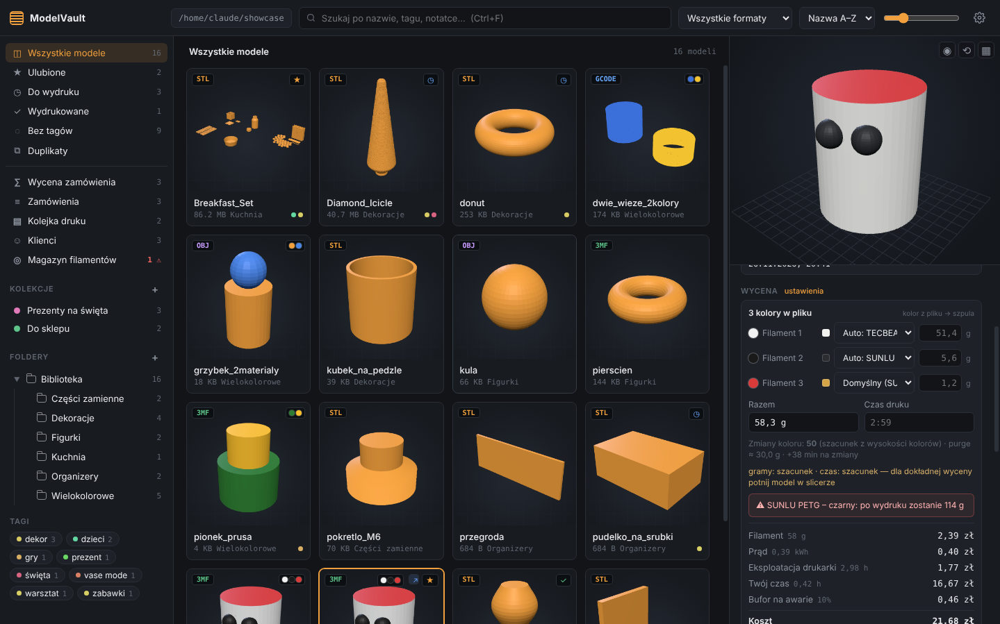
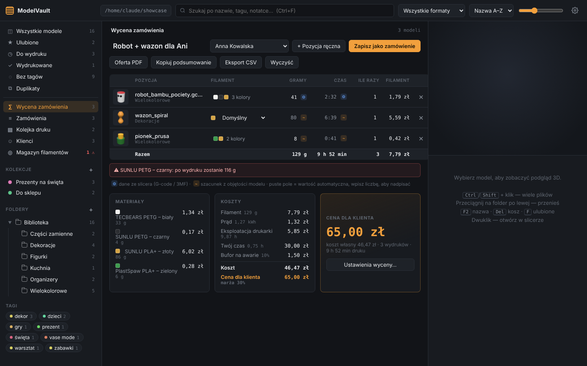
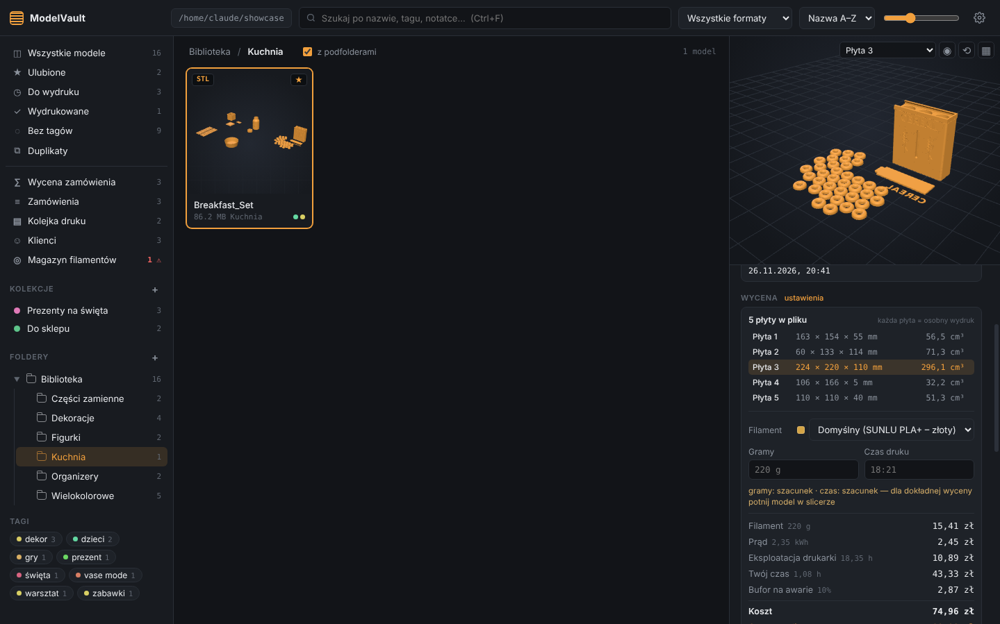
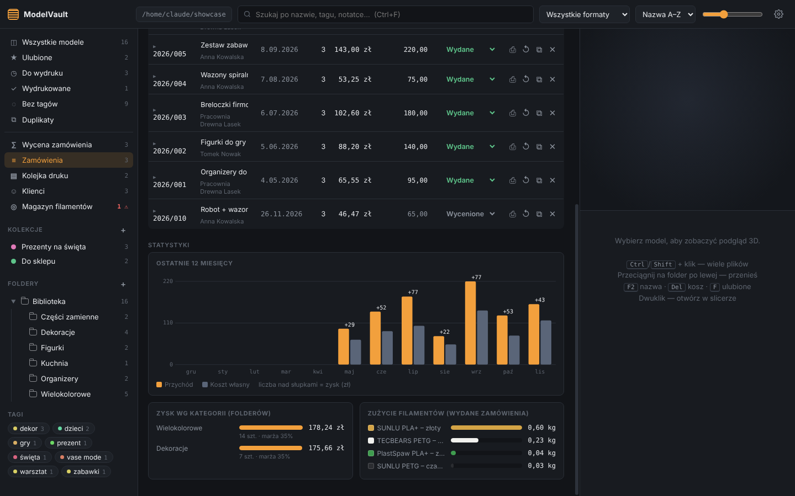
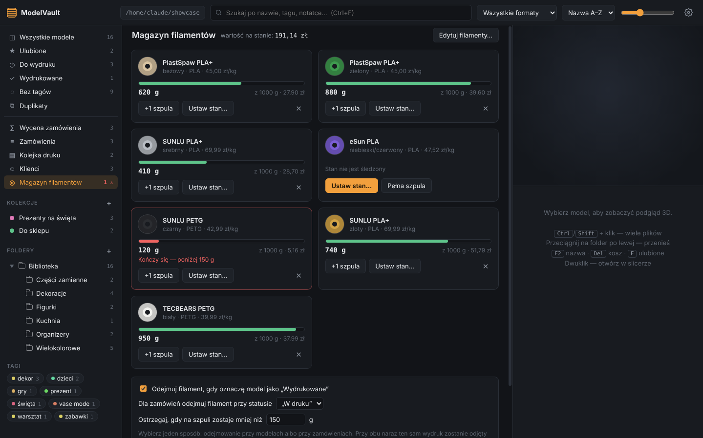
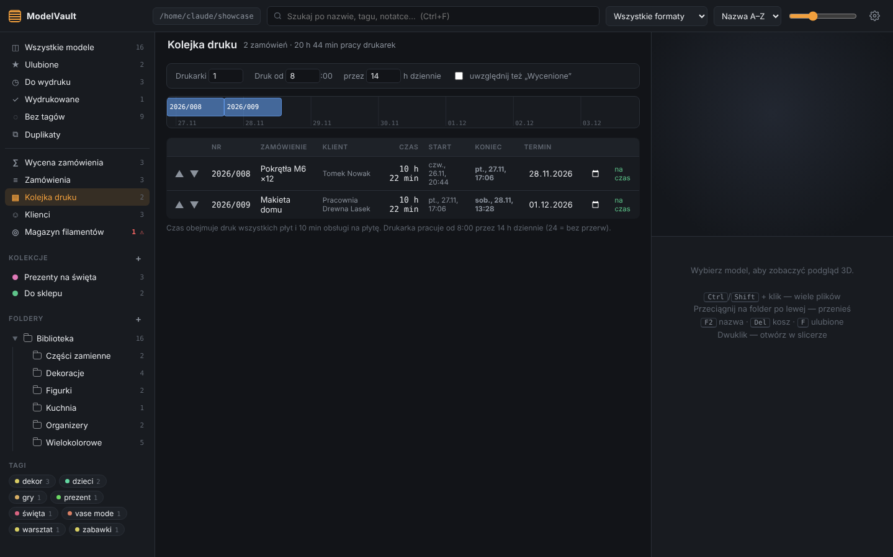
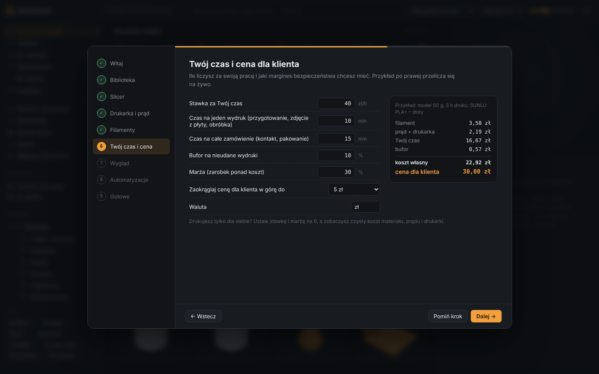
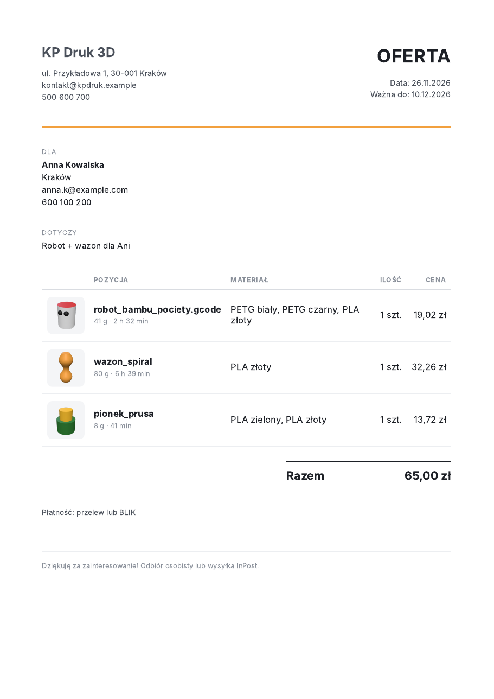

<div align="center">


# ModelVault

**Desktopowy menedżer biblioteki modeli do druku 3D: z podglądem, wyceną, zamówieniami i magazynem filamentów.**

[](https://github.com/K-Ptak/ModelVault/actions/workflows/ci.yml)


[](LICENSE)




</div>

---

ModelVault zamienia zwykły folder z plikami STL, 3MF i G-code w uporządkowaną bibliotekę.
Daje podgląd 3D, kategorie i tagi oraz wycenę każdego wydruku: z kosztem filamentu, prądu,
eksploatacji drukarki i Twojej pracy. **Pliki zostają tam, gdzie są.** Foldery to kategorie,
więc wszystko nadal działa w Eksploratorze, a aplikacja wykrywa zmiany na bieżąco.

> **Status:** wersja 1.0 jest w aktywnym rozwoju, przed pierwszym wydaniem.

## Spis treści
- [Funkcje](#funkcje)
- [Zrzuty ekranu](#zrzuty-ekranu)
- [Obsługiwane formaty](#obsługiwane-formaty)
- [Jak liczona jest wycena](#jak-liczona-jest-wycena)
- [Instalacja](#instalacja)
- [Jak to działa](#jak-to-działa)
- [Rozwój](#rozwój)
- [Licencja](#licencja)

## Funkcje

### 📁 Biblioteka
- **Folder jako biblioteka:** podfoldery to kategorie. Przenoszenie przez przeciąganie działa na prawdziwych plikach.
- **Tagi, ulubione, statusy** („do wydruku”, „wydrukowane”), notatki i link do źródła (Printables, MakerWorld, Thingiverse).
- **Kolekcje:** wirtualne grupy, np. „Prezenty na święta”, bez przenoszenia plików.
- **Wyszukiwanie** po nazwie, ścieżce, tagach i notatkach. Filtr formatów i sortowanie.
- **Wykrywanie duplikatów:** pliki o identycznej zawartości, nawet pod różnymi nazwami.
- **Skrzynka „Do posortowania”:** nowe modele z folderu Pobrane trafiają do biblioteki. Archiwa ZIP są rozpakowywane automatycznie.

### 🧊 Podgląd 3D
- **Podgląd na żywo** z obracaniem, siatką stołu, trybem wireframe i ścieżkami druku z G-code.
- **Miniatury:** osadzone przez slicer, z obrazka obok modelu albo renderowane. Kąt kamery i zdjęcie gotowego wydruku ustawiasz sam.
- **Modele wielokolorowe:** odczyt przypisań filamentów i malowania z plików 3MF (Bambu Studio, OrcaSlicer, PrusaSlicer) oraz narzędzi T0…Tn z G-code. Każdy kolor jest pokazany osobno.
- **Wiele płyt w jednym pliku:** wykrywanie płyt w eksportach z Bambu Studio / MakerWorld, podgląd pojedynczej płyty i wymiary każdej z nich.

### 💰 Wycena
- **Pełny koszt wydruku:** filament, prąd (z energią na start), amortyzacja i serwis drukarki, Twój czas, bufor na nieudane wydruki, marża i zaokrąglanie ceny.
- **Dane ze slicera:** gramy i czas z G-code (PrusaSlicer, OrcaSlicer, Bambu Studio, Cura) oraz z pociętych 3MF, osobno dla każdego filamentu, razem z purge. Bez danych ze slicera: szacunek z objętości modelu.
- **Wiele szpul na jeden model:** szpula dla każdego koloru, automatycznie dopasowana po kolorze z pliku. Szacunek liczby zmian koloru, purge i czasu zmian.
- **Wycena zamówienia** z wielu modeli i pozycji ręcznych. Eksport do CSV i kopiowanie podsumowania.

### 📦 Zamówienia, klienci i magazyn
- **Historia zamówień:** numeracja, statusy (wycenione → w druku → wydane), cena uzgodniona z klientem i notatki.
- **Baza klientów** z liczbą zamówień, przychodem i zyskiem.
- **Oferta PDF:** dokument z miniaturami, materiałami i cenami pozycji, gotowy do wysłania klientowi.
- **Kolejka druku:** harmonogram zamówień z przewidywanym końcem, z uwzględnieniem liczby drukarek i godzin pracy, oraz wykres Gantta i kontrola terminów.
- **Statystyki:** przychód, koszt i zysk z 12 miesięcy, zysk według kategorii i zużycie filamentów.
- **Magazyn filamentów:** stan szpul, wartość filamentu na stanie, ostrzeżenia o kończących się szpulach i automatyczne odejmowanie zużycia z możliwością cofnięcia.

### ⚙️ Wygoda
- **Kreator pierwszego uruchomienia:** folder, slicer, drukarka, ceny i marża z przykładową wyceną na żywo.
- **Integracja ze slicerami:** wykrywa zainstalowane slicery i otwiera model w wybranym jednym kliknięciem. Pokazuje tylko te, które masz.
- **Kopie zapasowe:** automatyczna dzienna kopia oraz eksport i import ustawień, zamówień, klientów i metadanych biblioteki.

## Zrzuty ekranu

<table>
  <tr>
    <td width="50%"><p align="center"><sub><b>Wycena zamówienia</b>: wiele modeli, wiele szpul, ostrzeżenia z magazynu</sub></p></td>
    <td width="50%"><p align="center"><sub><b>Wiele płyt w jednym STL</b>: każda płyta to osobny wydruk</sub></p></td>
  </tr>
  <tr>
    <td><p align="center"><sub><b>Zamówienia i statystyki</b>: przychód, koszt, zysk</sub></p></td>
    <td><p align="center"><sub><b>Magazyn filamentów</b>: stan szpul i historia zużycia</sub></p></td>
  </tr>
  <tr>
    <td><p align="center"><sub><b>Kolejka druku</b>: harmonogram i terminy</sub></p></td>
    <td><p align="center"><sub><b>Kreator konfiguracji</b>: wycena przeliczana na żywo</sub></p></td>
  </tr>
</table>

<details>
<summary><b>Przykładowa oferta PDF</b></summary>
<br>

</details>

## Obsługiwane formaty

| Format | Podgląd 3D | Kolory | Płyty | Dane do wyceny |
|---|:---:|:---:|:---:|---|
| **3MF** (Bambu Studio, OrcaSlicer) | ✅ | ✅ części, malowanie | ✅ z pliku | gramy per filament i czas (pocięty projekt) |
| **3MF** (PrusaSlicer) | ✅ | ✅ części, malowanie MMU | | szacunek |
| **3MF** (rdzeń, np. Fusion 360) | ✅ | ✅ materiały | ✅ wykrywane | szacunek |
| **G-code** | ✅ ścieżki | ✅ narzędzia T0…Tn | | gramy per filament, czas, zmiany koloru |
| **STL** | ✅ | | ✅ wykrywane | szacunek z objętości |
| **OBJ** | ✅ | ✅ materiały (`usemtl`) | ✅ wykrywane | szacunek z objętości |
| **PLY** | ✅ | ✅ kolory wierzchołków | | szacunek z objętości |
| STEP, SCAD, F3D, BLEND, AMF, GLB… | — | | | na liście, z tagami i notatkami |

## Jak liczona jest wycena

| Składnik | Wzór |
|---|---|
| Filament | gramy ÷ 1000 × cena za kg (osobno dla każdej szpuli) |
| Prąd | (czas druku × moc drukarki + liczba wydruków × energia na start) × cena kWh |
| Drukarka | czas druku × (cena drukarki ÷ żywotność + serwis za godzinę) |
| Twój czas | (liczba wydruków × czas na wydruk + czas na zamówienie) × stawka |
| Bufor | (filament + prąd + drukarka) × % na nieudane wydruki |
| **Koszt** | suma powyższych |
| **Cena dla klienta** | koszt × (1 + marża), opcjonalnie zaokrąglona w górę |

Każda płyta w pliku wielopłytowym liczy się jako osobny wydruk. Wszystkie parametry zmienisz w ustawieniach.

## Instalacja

> Pierwsze wydanie jest w przygotowaniu. Po publikacji instalator i wersja przenośna pojawią się
> w zakładce [Releases](https://github.com/K-Ptak/ModelVault/releases).

Planowane pliki wydania:
- **`ModelVault-Setup-x.y.z.exe`**: instalator ze skrótem w menu Start i automatycznymi aktualizacjami,
- **`ModelVault-x.y.z-win-x64.zip`**: wersja przenośna, bez instalacji.

Do tego czasu możesz uruchomić aplikację ze źródeł (patrz [Rozwój](#rozwój)).

## Jak to działa

- **Twoje pliki nie są przerabiane.** Biblioteka to folder na dysku, a operacje takie jak przenoszenie,
  zmiana nazwy czy usuwanie (do Kosza) działają na prawdziwych plikach.
- **Metadane biblioteki** (tagi, notatki, statusy, kolekcje, przypisane szpule) są w pliku `.modelvault.json`
  w głównym folderze biblioteki, więc przenoszą się razem z nią: na pendrive, OneDrive czy NAS.
  Jeśli przeniesiesz plik w Eksploratorze, metadane odnajdą go po nazwie i rozmiarze.
- **Ustawienia aplikacji** (filamenty, magazyn, klienci, zamówienia) są w `%APPDATA%\ModelVault`,
  razem z codziennymi kopiami zapasowymi.

<details>
<summary><b>Skróty klawiszowe</b></summary>

| Skrót | Akcja |
|---|---|
| Klik / Ctrl+klik / Shift+klik | zaznacz / dodaj do zaznaczenia / zakres |
| Strzałki | poruszanie po siatce |
| Dwuklik / Enter | otwórz w domyślnym slicerze |
| F2 | zmień nazwę |
| Del | przenieś do Kosza |
| F | ulubione |
| Ctrl+F | szukaj |
| Ctrl+A | zaznacz wszystko |
| Ctrl+, | ustawienia |
| Prawy przycisk | menu kontekstowe |

</details>

## Rozwój

**Wymagania:** Node.js 22+, Windows (do budowania instalatora).

```bash
git clone https://github.com/K-Ptak/ModelVault.git
cd ModelVault
npm install      # zależności + kopiowanie potrzebnych modułów three.js do renderer/vendor
npm start        # uruchomienie aplikacji
npm test         # testy logiki: wycena, pliki wielokolorowe, wykrywanie płyt
npm run dist     # lokalny build instalatora i wersji ZIP (folder dist/)
```

Testy na własnych plikach: `MV_REAL_DIR=ścieżka/do/folderu npm test`.

### Struktura projektu

```
├── main.js               # proces główny: system plików, metadane, slicery, kopie, aktualizacje, PDF
├── preload.js            # bezpieczny most IPC między oknem a procesem głównym
├── renderer/
│   ├── index.html        # interfejs
│   ├── app.js            # logika interfejsu: biblioteka, wycena, zamówienia, magazyn, kreator
│   ├── viewer.js         # podgląd 3D i miniatury (three.js)
│   ├── mc.js             # parsery wielokolorowe: 3MF, ścieżki G-code
│   ├── plates.js         # wykrywanie wielu płyt w pliku
│   ├── pricing.js        # wycena i odczyt danych ze slicerów
│   └── styles.css
├── test/                 # testy (node:test) i pliki testowe
├── scripts/vendor.js     # kopiuje potrzebne moduły three.js
└── .github/workflows/    # CI (testy) i budowanie wydań
```

### Wydanie nowej wersji
1. Ustaw `version` w `package.json` i zrób commit.
2. `git tag v1.0.0 && git push origin v1.0.0`
3. GitHub Actions uruchomi testy, zbuduje instalator i ZIP na Windows i opublikuje Release.
   Zainstalowane aplikacje zaproponują aktualizację.

### Technologie
[Electron](https://www.electronjs.org/) · [three.js](https://threejs.org/) · [fflate](https://github.com/101arrowz/fflate) ·
[electron-builder](https://www.electron.build/) · [electron-updater](https://www.electron.build/auto-update)

## Licencja

Projekt jest udostępniony na licencji [MIT](LICENSE): możesz go używać, modyfikować i rozpowszechniać,
również komercyjnie, pod warunkiem zachowania informacji o autorze i treści licencji.

© 2026 K-Ptak
